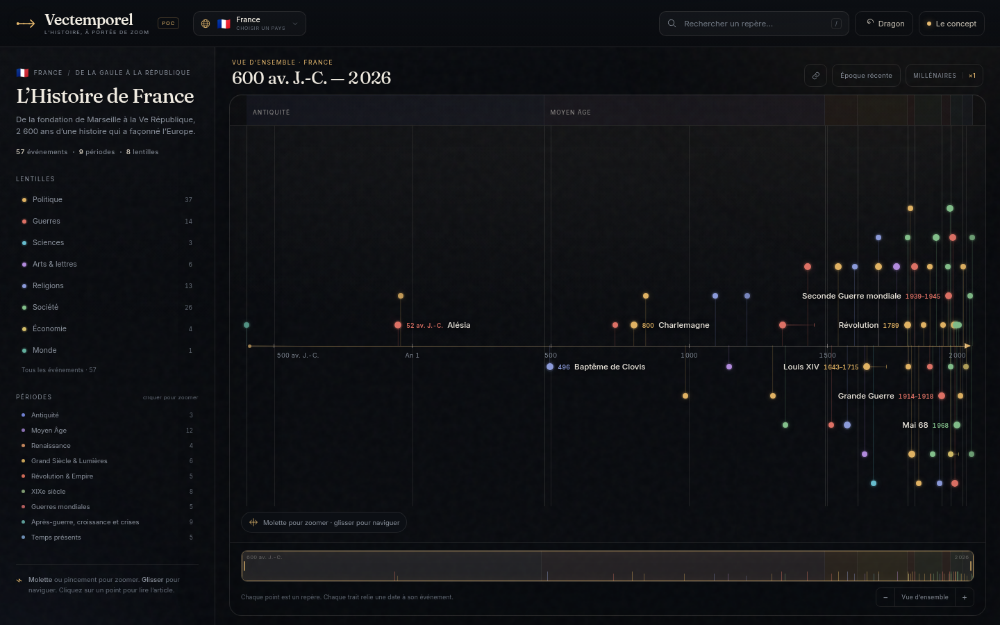
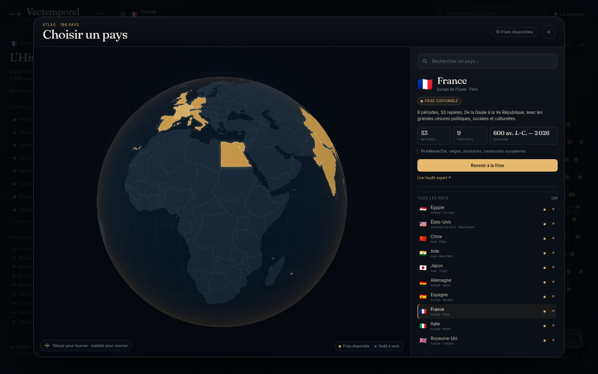
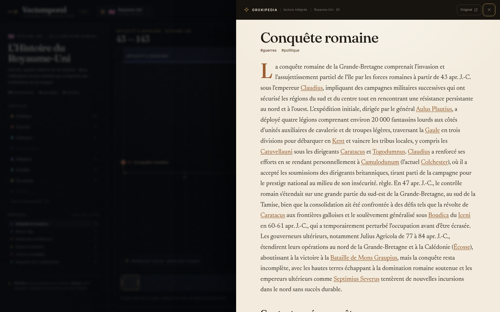
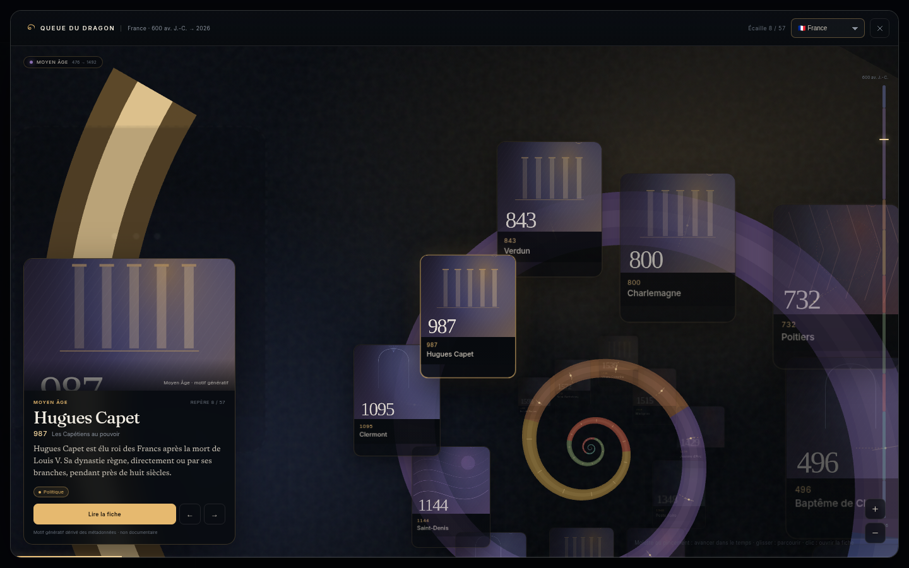
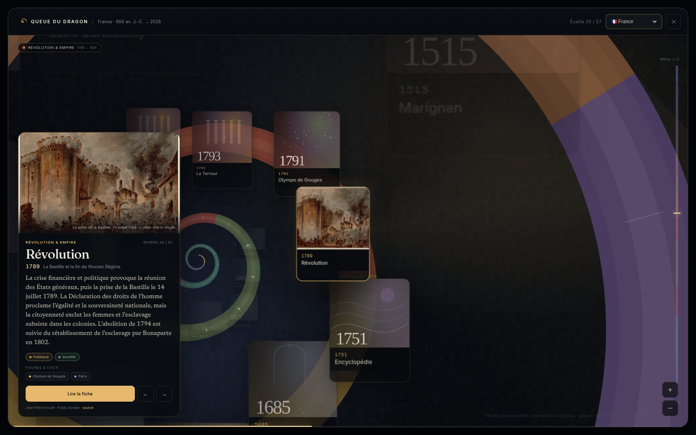
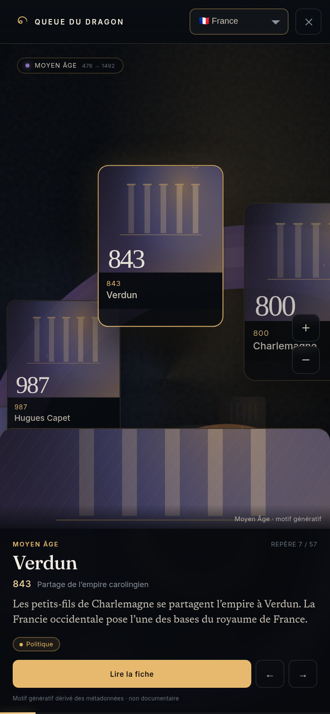

# Vectemporel — POC

**L’Histoire, à portée de zoom.**

Une frise historique zoomable, pays par pays, avec des événements tagués et un lecteur Grokipedia intégré, **traduit automatiquement en français**. Ce dépôt est un **proof of concept** : il sert à discuter du concept, pas à être déployé tel quel.

> La note de concept complète est dans **[CONCEPT.md](CONCEPT.md)**. La méthode de production d’une frise est dans **[TIMELINE_METHOD.md](TIMELINE_METHOD.md)** et la recherche sur la forme narrative dans **[SPIRAL_TIMELINE.md](SPIRAL_TIMELINE.md)** et le design du canevas zoomable dans **[DRAGON_TIMELINE.md](DRAGON_TIMELINE.md)**. Les 10 dossiers pays sont dans **[audits/](audits/)** ; leur synthèse est dans **[AUDIT_SYNTHESIS.md](AUDIT_SYNTHESIS.md)** et le rapport d’intégration dans **[INTEGRATION_REPORT.md](INTEGRATION_REPORT.md)**. Les audits prose sont dans **[COUNTRY_AUDITS.md](COUNTRY_AUDITS.md)**, l’audit structurel généré dans **[TIMELINE_AUDIT.md](TIMELINE_AUDIT.md)** et la liste des 196 pays dans **[COUNTRIES.md](COUNTRIES.md)**.













---

## Lancer le POC

Prérequis : **Node.js 20+** et un accès réseau à Grokipedia et au service de traduction pour le lecteur.

```bash
npm install
npm run build:atlas   # régénère countries.js / COUNTRIES.md
npm run build:globe   # régénère les textures du globe 3D
npm run build:spiral-meta  # régénère les acteurs/lieux par ère
npm run build:event-images # régénère les images documentaires vérifiées
npm run audit:timeline  # régénère TIMELINE_AUDIT.md
npm start
```

Ouvrir **http://localhost:4173**.

Le serveur peut aussi écouter sur un autre port :

```bash
PORT=8080 npm start
```

Aucun build front n’est nécessaire : `index.html`, `styles.css`, `app.js`, `data.js`, `countries.js`, `globe-engine.js`, `dragon.js`, `spiral-meta.js`, `event-images.js` et les images du globe sont servis directement.

---

## Ce que contient le POC

### La queue du dragon

- Un **canevas zoomable** de type Prezi : le zoom fait avancer ou reculer dans le temps.
- Une spirale logarithmique auto-similaire : chaque écaille est ~10 % plus petite que la précédente.
- 10 pays, 229 repères : une écaille = un repère, avec ère, tags, figures et lieux.
- Des **images** : 10 photographies/œuvres vérifiées sur Wikimedia Commons (crédit et licence affichés) et un motif génératif signalé « non documentaire » pour les autres.
- Navigation : molette, pincement, glisser, flèches, rail de profondeur, clic sur une écaille.
- Three.js à la demande : scène statique, 15 écailles DOM recyclées, rendu arrêté au repos.
- La frise linéaire reste l’outil de recherche ; le dragon est le mode narratif.
- Design complet : **[DRAGON_TIMELINE.md](DRAGON_TIMELINE.md)**. Images : **[EVENT_IMAGES.md](EVENT_IMAGES.md)**.

### L’atlas 3D

- Un globe WebGL Three.js pour choisir un pays, tourner, zoomer et cliquer.
- Une seule sphère texturée : **1 draw call, ~5 000 triangles, 2 textures**.
- Résolution adaptée au budget de pixels, arrêt du rendu quand l’atlas est fermé.
- **196 pays listés**, dont **10 frises disponibles** et **186 audits à venir**.
- Fiche pays avec région, capitale, statut, résumé d’audit et lien vers l’audit complet.
- Recherche et liste complète des pays accessibles sans le globe.
- Audits détaillés : `COUNTRY_AUDITS.md`. Liste complète : `COUNTRIES.md`.

### La frise

- 10 pays : France, Royaume-Uni, États-Unis, Allemagne, Italie, Espagne, Chine, Inde, Japon, Égypte.
- 229 événements curatés à la main (189 initiaux + 40 ajouts issus des audits).
- Un atlas de 196 pays, dont 10 frises disponibles et 186 audits à venir.
- 8 tags : politique, guerres, sciences, arts & lettres, religions, société, économie, monde.
- Des ères colorées, cliquables pour zoomer.
- Un axe fléché, des graduations adaptatives (millénaires → années).
- Placement automatique des labels au-dessus et en dessous de l’axe.
- Événements à durée (`Guerre de Cent Ans`, `Louis XIV`, etc.) rendus par un trait de période.
- Mini-carte avec fenêtre de navigation.
- Zoom molette / pincement, pan, double-clic, boutons, clavier.
- Filtres par tags, recherche globale (événement ou année), deep links.

### Le lecteur

- Chaque événement ouvre un panneau latéral sans quitter la frise.
- Ouverture directe : titre français, hashtags, puis texte de l’article.
- Article Grokipedia extrait et **traduit en français**, sans titre dupliqué ni résumé intercalé.
- Contexte pays/date dans la barre du lecteur.
- Navigation entre les liens Grokipedia internes, avec retour.
- Repli sur la recherche Grokipedia si une page directe manque.
- Lien vers l’article original et mention de source.

### L’interface

- Desktop, tablette et mobile.
- Thème sombre éditorial, papier chaud pour la lecture.
- Recherche multi-pays.
- Modale « Le concept ».
- Deep link partageable, par exemple :
  `#/france/1789-1799/fr-revolution`

---

## Méthode de création d’une frise

La méthode complète est dans **[TIMELINE_METHOD.md](TIMELINE_METHOD.md)**. Elle remplace l’objectif impossible d’exhaustivité par une **couverture systématique** et un **registre des omissions explicites** : une frise n’est pas complète, elle est auditée.

Le pipeline comporte 11 étapes (0 à 10), chacune avec un livrable et une porte qualité :

- **0 — Cadrage** : territoire, populations, bornes, exclusions.
- **1 — Historiographie** : écoles, récits concurrents, controverses.
- **2 — Corpus** : sources indépendantes et critique de source.
- **3 — Inventaire** : événements, processus, acteurs, institutions, lieux.
- **4 — Périodisation** : au moins trois périodisations candidates.
- **5 — Couverture** : matrice `périodes × domaines × échelles`.
- **6 — Sélection** : repères centraux et étendus, avec critères explicites.
- **7 — Qualification** : `TimeSpan`, claims, provenance, incertitude.
- **8 — Audit** : double lecture, arbitrage, scores, sign-off.
- **9 — Mise en scène** : labels, niveaux de lecture, accessibilité.
- **10 — Publication** : release, changelog, maintenance.

Les gabarits opérationnels sont dans **[templates/](templates/)** :

- `templates/country-audit.yaml` — dossier pays complet ;
- `templates/event-record.yaml` — fiche-événement avec acteurs, lieux, claims et sources ;
- `templates/coverage-matrix.csv` — matrice des 14 domaines ;
- `templates/source-register.csv` — registre des sources ;
- `templates/omissions.yaml` — registre des omissions explicites.

L’audit structurel est automatisé :

```bash
npm run audit:timeline          # régénère TIMELINE_AUDIT.md
npm run audit:timeline:strict   # échoue si la cible v1.0 est < 80/100
npm run audit:dossiers          # contrôle structurel des dossiers pays
npm run verify:sources          # vérifie les DOI et URL des 200 sources
```

État après intégration : **229 repères**, **120/120 contrôles d’intégrité**, **27,6/100 de complétude cible**, **49 % de couverture tags × ères**, **121 corrections**, **40 ajouts** et **22 renommages d’ères**. Les 189 pages Grokipedia directes restent valides ; 40 nouveaux repères utilisent la recherche Grokipedia en fallback. `data.js` ne porte toujours ni acteurs, ni lieux, ni claims, ni `TimeSpan`. Le détail est dans **[TIMELINE_AUDIT.md](TIMELINE_AUDIT.md)**, **[INTEGRATION_REPORT.md](INTEGRATION_REPORT.md)** et **[AUDIT_SYNTHESIS.md](AUDIT_SYNTHESIS.md)**.

---

## Installation comme webapp Omarchy

Le POC est aussi installé comme une vraie webapp dans le menu Omarchy :

- **Entrée de menu** : `~/.local/share/applications/Vectemporel.desktop`
- **Icône** : `~/.local/share/icons/hicolor/256x256/apps/vectemporel.png`
- **Serveur local** : `~/.config/systemd/user/vectemporel.service`, activé au login
- **Lanceur** : `~/.local/bin/vectemporel-webapp` (démarre le service si besoin, puis ouvre ou focus la fenêtre)

L’application apparaît **une seule fois**, sous le nom **Vectemporel**, dans le lanceur d’applications (`Super + Space`). Le service écoute sur `http://127.0.0.1:4173`.

Commandes utiles :

```bash
systemctl --user status vectemporel.service
journalctl --user -u vectemporel.service -f
omarchy menu refresh
```

> Le service démarre automatiquement le serveur. Si vous lancez `npm start` en parallèle, le port 4173 sera déjà occupé.

---

## Vérifier les liens Grokipedia

```bash
npm run verify
```

Le script teste les 189 slugs Grokipedia directs utilisés dans `data.js` et affiche les éventuelles pages manquantes. Au moment de la rédaction : **189/189 valides**. Les 40 repères ajoutés sans page directe utilisent la recherche Grokipedia.

---

## Architecture

```text
index.html          structure
countries.js        registre des 196 pays
globe-map.png       texture visuelle du globe
globe-pick.png      texture de sélection pays
globe-engine.js     moteur Three.js optimisé
dragon.js           canevas zoomable Three.js
spiral-meta.js      acteurs et lieux par ère
vendor/three.min.js Three.js r152 (UMD)
COUNTRY_AUDITS.md   audits des 10 pays pilotes
COUNTRIES.md        liste complète des pays
TIMELINE_METHOD.md  méthode de production d’une frise (11 étapes)
SPIRAL_TIMELINE.md  recherche sur la forme narrative
DRAGON_TIMELINE.md  design du canevas zoomable
EVENT_IMAGES.md     registre des images et licences
TIMELINE_AUDIT.md   audit structurel généré
SOURCE_VERIFICATION.md vérification des sources des dossiers
audits/             dossiers d’audit des 10 pays pilotes
AUDIT_SYNTHESIS.md  synthèse comparative des 10 audits
INTEGRATION_REPORT.md corrections et ajouts appliqués
templates/          gabarits pays, événement, couverture, sources
styles.css          design system + responsive
app.js              état, frise, recherche, lecteur, URL
data.js             pays, ères, événements, tags
server.mjs          serveur statique + proxy Grokipedia
scripts/audit-timeline.mjs
scripts/check-audit-dossiers.mjs
scripts/build-spiral-meta.mjs
scripts/build-event-images.mjs
scripts/verify-sources.mjs
scripts/verify-grok.mjs
CONCEPT.md          note de concept
```

Le serveur Node :

1. sert les fichiers statiques ;
2. expose `/api/grokipedia?slug=...&q=...` ;
3. récupère la page publique ;
4. extrait le corps de l’article avec `cheerio` ;
5. nettoie le HTML avec `sanitize-html` ;
6. traduit les blocs en français via un endpoint Google Translate non officiel ;
7. met en cache le résultat pendant 6 heures.

### Pourquoi un proxy ?

Grokipedia interdit l’intégration en iframe (`Content-Security-Policy: frame-ancestors 'none'`). Le POC extrait donc le contenu lisible et le réaffiche dans son propre lecteur. Ce n’est **pas** une intégration officielle : voir les limites ci-dessous.

---

## Données

Chaque événement a la forme suivante :

```js
{
  id: 'fr-revolution',
  year: 1789,
  title: 'Révolution',
  subtitle: 'La Bastille et la fin de l’Ancien Régime',
  tags: ['politique', 'societe'],
  importance: 3,
  summary: '…',
  grok: 'French_Revolution',
  related: ['fr-terreur', 'fr-brumaire'],
}
```

Un événement peut avoir `endYear` pour représenter une période. Les années négatives sont avant J.-C. ; l’affichage utilise `An 1` pour l’année zéro.

Ce schéma est **volontairement minimal** : c’est celui du POC. Le schéma cible de la méthode ajoute `actors`, `places`, `sources`, `claims`, `time` (`TimeSpan`), `datePrecision` et un registre d’omissions. Il est décrit dans **[TIMELINE_METHOD.md](TIMELINE_METHOD.md)** et matérialisé par **[templates/event-record.yaml](templates/event-record.yaml)**.

Les données sont dans `data.js`. Pour ajouter un pays, ajouter une entrée dans `countries` avec son domaine temporel, ses ères et ses événements.

---

## Raccourcis

| Touche | Action |
| --- | --- |
| `/` ou `Ctrl/Cmd + K` | Rechercher |
| `+` / `−` | Zoomer / dézoomer |
| `0` | Vue d’ensemble |
| `←` / `→` | Se déplacer dans le temps |
| `Échap` | Fermer recherche / lecteur / concept |
| `?` | Ouvrir la note de concept |

Sur la frise : molette pour zoomer, glisser pour naviguer, double-clic pour zoomer. Sur mobile : pincement, glisser, boutons et mini-carte.

---

## Limites assumées

- **POC, pas produit.** Données statiques, pas de comptes, pas de back-office, pas de quiz, pas de carte historique.
- **Traduction automatique.** L’article est traduit à la volée par un service externe (Google Translate non officiel), ce qui implique d’envoyer le texte de l’article à ce service. La qualité est perfectible et la source originale reste accessible. Une version production devrait utiliser une API contractuelle et une relecture éditoriale.
- **Pas d’API officielle.** Le lecteur extrait des pages publiques à des fins de démonstration. Une version production devrait passer par un accord, une API ou un contenu sous licence.
- **Vectemporel n’est pas affilié à Grokipedia.**
- **Sélection éditoriale.** 229 événements ne constituent pas une histoire exhaustive ; c’est un jeu de données pour valider l’expérience.
- **Schéma de preuve incomplet.** Le POC ne stocke ni acteurs, ni lieux, ni sources indépendantes, ni claims, ni `TimeSpan`. L’audit structurel le mesure : la cible v1.0 est à 27,6/100. Les 121 corrections et 40 ajouts sont intégrés, mais les acteurs, lieux, claims et `TimeSpan` restent à instrumenter. Une frise publiable selon la méthode doit combler ces champs et documenter ses omissions.
- **Dépendance réseau.** Sans accès à Grokipedia ou au service de traduction, le lecteur affiche un repli ; la frise reste utilisable.

---

## Prochaines étapes suggérées

1. Instrumenter le schéma de preuve v1.0 : `Actor`, `Place`, `Source`, `Claim`, `TimeSpan`, `datePrecision`.
2. Remplir les gabarits pays, la matrice de couverture et le registre d’omissions pour les 10 pays pilotes.
3. Trancher le public prioritaire (grand public vs scolaire).
4. Décider du rapport à Grokipedia (lien, lecteur proxy, partenariat).
5. Élargir à 20–30 pays avec un back-office éditorial.
6. Ajouter les parcours guidés, les quiz et la comparaison de pays.

La note **[CONCEPT.md](CONCEPT.md)** détaille la vision, le modèle de données, l’architecture cible, les métriques et les risques.

---

## Crédits techniques

- Globe 3D : [Three.js](https://threejs.org/) (MIT) avec un moteur de rendu dédié.
- Frontières : Natural Earth via [world-atlas](https://github.com/topojson/world-atlas), domaine public.
- Noms, capitales et coordonnées : [world-countries](https://github.com/mledoze/countries), ODbL.
- Textes source : Grokipedia, avec traduction automatique via Google Translate.
